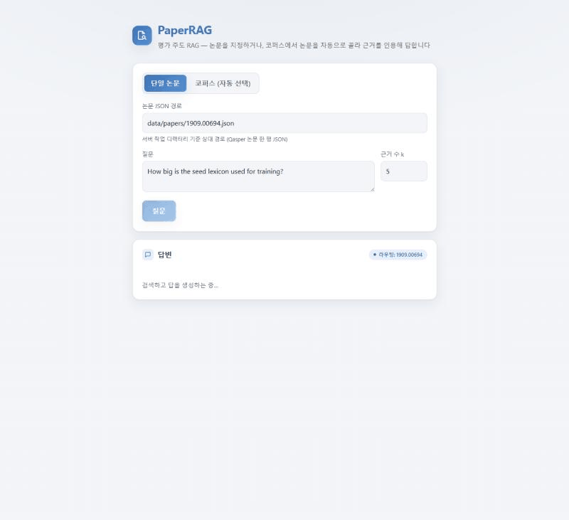
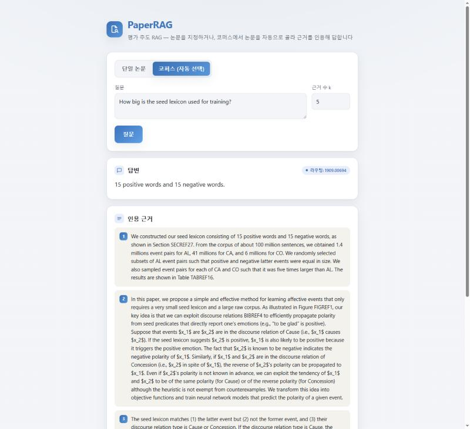
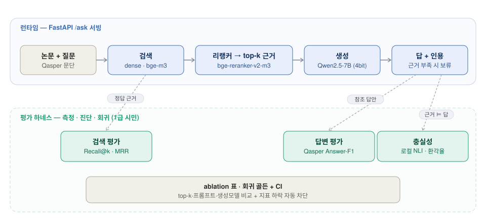

# PaperRAG — AI/ML 논문 질의응답 RAG

> AI/ML 논문(arXiv·NLP)에 질문하면 근거 문단을 인용해 답한다. 초점은 답변 자체보다, 검색과 답변의 품질을 수치로 측정하고 개선하는 평가 하네스에 있다.

개발 과정은 [DEVELOPMENT_JOURNEY](DEVELOPMENT_JOURNEY.md)에, 상세 지표와 측정 조건은 [EVALUATION](EVALUATION.md)에 정리했다.

## 한눈에

- 문제: RAG 데모는 대개 답을 보여줄 뿐, 검색이 맞는 문단을 가져왔는지, 답이 근거에 충실한지를 측정하지 않는다.
- 접근: 먼저 검색 평가(Hit@k·Recall@k·MRR)와 답변 평가(Qasper Answer-F1, 로컬 NLI 기반 충실성·환각률)를 세운다. 그 위에서 리랭커·top-k·프롬프트·생성 모델을 축으로 ablation을 돌리고, 지표가 조용히 나빠지지 않도록 골든 비교 회귀 테스트를 CI에 걸었다.
- 채점은 전부 무료이고 재현 가능하다(gold evidence + 표준 F1 + 로컬 NLI). Claude API는 필수 의존이 아니라, 로컬 생성과 비교하는 선택 축이다.
- 스택: 로컬 GPU(RTX 3080)에서 임베딩(bge-m3)·리랭커(bge-reranker-v2-m3)·NLI·생성(Qwen2.5-7B)을 돌리고, FastAPI로 서빙한다.

## 구현 범위

**1단계 — 논문 한 편을 골라 질문하는 QA.** 선택한 논문 안에서 근거 문단을 검색하고(BM25·dense·hybrid·리랭커), Qwen2.5-7B가 그 근거로 답하며 인용 문단을 함께 돌려준다. 근거가 답을 담지 못하면 보류한다. 검색(Hit@k·Recall@k·MRR)과 답변(Answer-F1·NLI 충실성)을 평가하고, 리랭커·top-k·프롬프트·생성 모델 축으로 ablation을 측정했다. 골든 대비 지표 하락은 회귀 테스트로 막는다(CPU는 GitHub Actions 자동, GPU는 로컬 수동). 서빙은 FastAPI `/ask`와 스트리밍 응답, 전용 웹 UI까지 올렸다.

**2단계 — 코퍼스에서 논문을 골라 그 논문에 질문하는 QA.** 50편 3011문단을 한 번 임베딩해 영속 인덱스로 만들고(정규화 벡터 전수 내적, FAISS IndexFlatIP와 같은 의미), 질문으로 논문을 먼저 고른 뒤(top-1 라우팅) 고른 논문 안에서만 근거를 검색하는 2단계 구조다. 논문 선택 정확도(recall@k·MRR)를 재고, end-to-end를 ①라우팅 → ②논문 내 검색 → ③답변 3단계로 조건부 분해해 병목이 어디인지 측정했다. 서빙은 `/ask/corpus`와 UI 모드 토글로 올렸다.

**다음 — 여러 논문을 종합하는 답변은 후속 후보로 둔다.** 설계와 완료 기준은 DEVELOPMENT_JOURNEY의 P0-7·P0-7.1에 있다.

## 핵심 성과표

_10편 개발용 부분집합(micro 평균) — 검색 축은 보류 규칙을 통과한 26문항, 답변 축은 전체 51문항. 검색은 BM25 베이스라인 대비 best config(dense→리랭커), 답변 축은 oracle 근거(천장) 대비 검색 근거(실제)의 진단이다. 상세·조건은 [EVALUATION](EVALUATION.md)._

**검색 (BM25 → dense→리랭커)**

| 지표 | BM25 | dense→리랭커 | Δ |
|---|---|---|---|
| Hit@5 | 0.385 | 0.692 | +0.308 |
| Recall@5 | 0.346 | 0.577 | +0.231 |

**답변 축 진단 (oracle 근거 → 검색 근거)**

| 지표 | oracle(천장) | 검색(실제) |
|---|---|---|
| Answer-F1 | 0.533 | 0.416 |
| 충실율(NLI) | 0.778 | 0.615 |
| 환각율 | 0.222 | 0.385 |

검색 품질이 답 품질의 천장이다. 검색이 gold 문단을 top-5에 못 올리면 정확도와 충실성이 함께 떨어진다(B-8·B-9). 작동점은 근거 수 k=5다. Answer-F1이 k=5에서 최대이고, k=10은 추가 근거의 노이즈로 오히려 떨어진다(0.416→0.366, B-15).

### 코퍼스 라우팅 — 50편에서 논문을 고르고 답하기

_196문항·50편 전체. 논문 선택은 문단 점수를 논문별 max로 집계해 top-1 라우팅. 상세·조건은 [EVALUATION](EVALUATION.md)._

**① 논문 선택 (recall@k·MRR)**

| recall@1 | recall@3 | recall@5 | MRR |
|---|---|---|---|
| 0.444 | 0.602 | 0.643 | 0.549 |

**end-to-end 3단계 조건부 분해 (top-1 라우팅 작동점, 앞 관문이 성공한 부분집합에서만 측정)**

| 관문 | 측정 | 값 | 표본 |
|---|---|---|---|
| ① 라우팅 | top-1 = gold 논문 | 47/196 | 196 |
| ②\|① 논문 내 검색 | Hit@5 | 0.660 | 47 |
| ③\|② 답변 | Answer-F1 | 0.483 | 31 |

근거를 top-5에 확보하고도(③ 진입) Answer-F1이 ~0.48에 머문다 — 이 작동점의 병목은 검색이 아니라 생성이다(B-20). 각 관문을 앞 관문이 성공한 부분집합에서만 재야 "논문을 틀린 것"과 "문단을 못 잡은 것"이 섞이지 않는다. ②는 리랭커 없는 dense-only라 하한에 가깝고, 표본이 작아(②47·③31) 해석에 주의한다.

## 데모

아래는 GPU 없이 CPU만으로 돌려 볼 수 있는 최소 실행이다. 입력 JSON은 Hugging Face Qasper 논문 한 행을 저장한 형식이라 따로 준비해야 한다.

```powershell
python -m venv .venv
.\.venv\Scripts\python.exe -m pip install rank-bm25==0.2.2 numpy==2.2.6
.\.venv\Scripts\python.exe -m src.retrieve.bm25 data/qasper-train-first-paper.json "How big is seed lexicon used for training?" --top-k 5
.\.venv\Scripts\python.exe -m src.eval.retrieval data/qasper-train-first-paper.json --top-k 5
.\.venv\Scripts\python.exe -m unittest discover -s tests -v
```

평가 명령은 질문별 검색 ID·점수·Hit·Recall·RR과 질문 평균, 보류 사유를 JSON으로 출력한다. 첫 샘플에서는 9개 중 4개를 평가하고 5개를 보류한다. 전체 벤치마크가 아니라 개발용 실행 결과이며, 포함 조건과 수치는 [EVALUATION의 B-3](EVALUATION.md#b-3-bm25-4개-질문-평가-2026-09-18)에 있다.

로컬 GPU가 있으면 dense(bge-m3)·리랭커 검색과 BM25·dense·hybrid 비교, Qwen2.5-7B 답변 생성과 Answer-F1 채점까지 돌릴 수 있다. 결과는 [EVALUATION](EVALUATION.md)의 B-6·B-8에 정리했다. 회귀 테스트는 골든(`baselines/retrieval.json`) 대비 검색 지표가 떨어지면 실패하고(B-11~B-13), config·top-k별 ablation 표도 재생성한다.

**W4 — FastAPI 서빙: 전용 웹 UI + `/ask` (Swagger `/docs`)**



논문 한 편과 질문을 주면 검색(dense→리랭커)으로 근거 문단을 모아 로컬 7B가 답하고, 인용 문단과 함께 반환한다. 근거가 답을 담지 못하면 보류한다(`abstained`). 세 모델은 서버가 뜰 때 한 번 로딩해 상주시킨다. 10GB VRAM 제약 때문에 경량 모델(임베더·리랭커)은 CPU에, 7B만 GPU 4bit에 둔다. 그래서 7B 로드(~28초)는 기동 때 한 번뿐이고 이후 요청은 바로 답한다(B-14).

루트 `/`에서는 전용 웹 UI를 제공한다. 질문을 넣으면 `/ask/stream`(SSE)으로 생성 토큰이 실시간으로 흐르고, 인용 문단과 보류 배지를 함께 보여준다(B-16).

```powershell
.\.venv\Scripts\python.exe -m pip install fastapi==0.115.6 "uvicorn[standard]==0.34.0"
.\.venv\Scripts\python.exe -m uvicorn src.serve.app:app
# http://127.0.0.1:8000/ 전용 웹 UI (질문 입력·실시간 스트림)
# http://127.0.0.1:8000/docs Swagger 에서 /ask 직접 호출 (paper_path, question)
```

**코퍼스 모드 — 논문을 지정하지 않은 질문을 라우팅해 답한다: `/ask/corpus`**



질문만 주면 코퍼스 50편에서 top-1 논문을 고르고(라우팅), 그 논문 안에서 검색(dense→리랭커)→생성으로 답한다. 응답에는 라우팅된 논문 ID를 함께 표시한다. 웹 UI에서 "코퍼스 (자동 선택)" 모드를 고르면 되고, 위 예에서 "How big is the seed lexicon used for training?"는 1909.00694로 라우팅돼 근거 5개와 함께 답했다(B-21). 이 모드는 코퍼스 문단 인덱스가 필요하다(재생성: `python -m src.index.corpus`).

## 아키텍처



런타임은 논문과 질문을 받아 검색(dense bge-m3) → 리랭커(bge-reranker-v2-m3) → 생성(Qwen2.5-7B)으로 답과 인용을 내고, 근거가 부족하면 보류한다. 코퍼스 모드는 이 파이프라인 앞에 논문 라우팅(코퍼스 인덱스 → top-1) 한 단계를 더해 같은 검색·생성 코어를 재사용한다(다이어그램 상단의 코퍼스 모드 경로). 평가 하네스는 각 단계를 gold evidence·reference answer·NLI로 측정하고, ablation과 회귀 골든(CI)으로 지표 하락을 막는다.

## 문서

- [DEVELOPMENT_JOURNEY.md](DEVELOPMENT_JOURNEY.md) — 개발 일지 (기술 결정·정량 로그)
- [EVALUATION.md](EVALUATION.md) — 평가 방법·상세 지표 표

## 데이터·라이선스

평가·코퍼스: **Qasper** (Allen Institute for AI, NLP 논문 QA). arXiv 논문 라이선스는 논문별로 다르므로 사용 시 명시한다.
